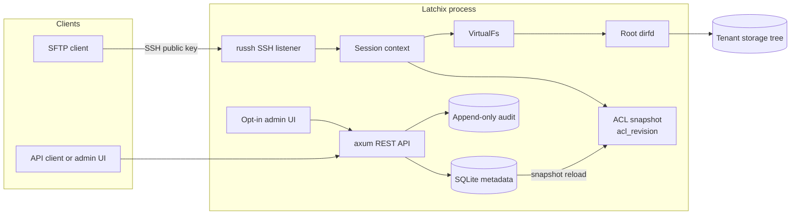
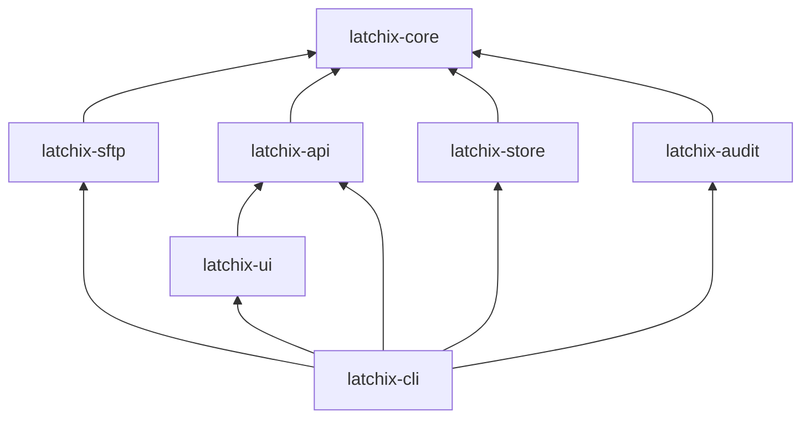
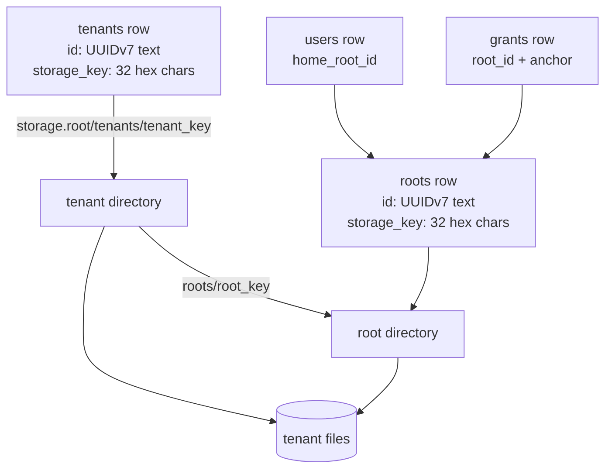
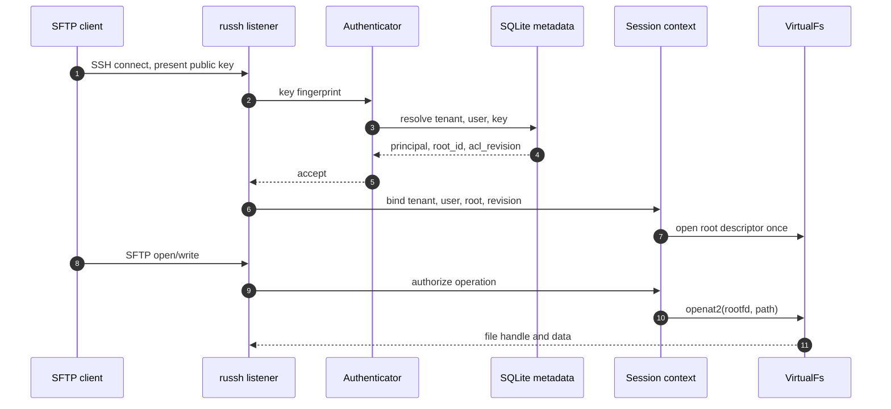
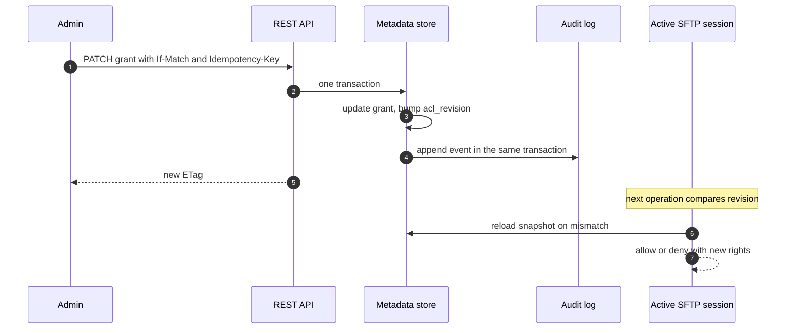
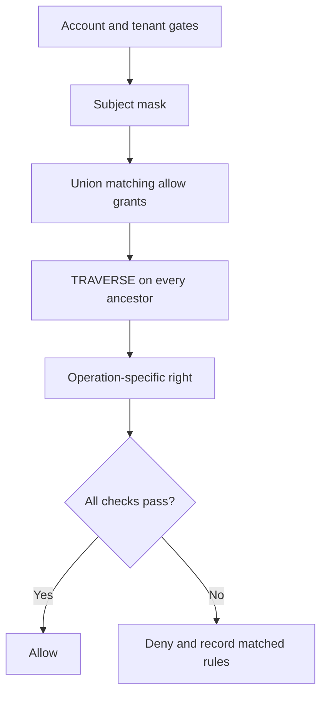
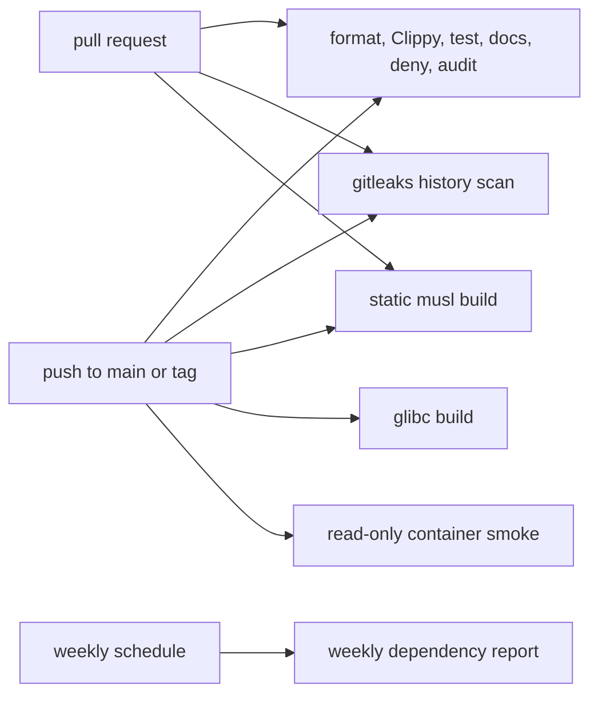

# Phase 0 Reader: Decisions Before Code

- Status: Learning material
- Audience: Musa
- Scope: Phase 0 decisions, ADRs 0001 to 0006, scaffold, packaging, CI
- Source of truth: [BLUEPRINT.md](../../BLUEPRINT.md), [docs/PLAN.md](../PLAN.md), [docs/decisions](../decisions)

This is a reader, not a test. You do not need to answer anything today. Read the
notes, look at the diagrams, and mark the parts that still feel fuzzy. The
checkpoints in [LEARNING.md](../LEARNING.md) can wait.

The goal is narrower than "learn Rust" or "learn SFTP". The goal is to own the
shape of the system: why the schema has tenants, why the filesystem boundary is
a descriptor, why SQLite is enough, why the UI is optional, and why the binary
is the product.

---

## 1. Phase 0 in one page

Phase 0 decided the expensive things before code existed:

1. **Tenancy is in the v0.1 schema.** A single-tenant schema would be cheap now
   and expensive forever. Every tenant-owned row carries `tenant_id`.
2. **The root is a filesystem boundary, not a string.** A session opens the
   tenant root once and resolves every path relative to that descriptor.
3. **The database ACL is the only authorization authority.** POSIX mode bits
   are defense in depth, never the access decision.
4. **SQLite is the only metadata store in v0.1 and v0.2.** Postgres is not
   scheduled. It is added only when a documented trigger is met.
5. **The API is the primary interface.** The admin UI is an opt-in Cargo feature
   and a client of the same API.
6. **The static binary is the product.** The OCI image is a packaging channel.
   The Rust library stays internal until v0.2.
7. **IDs and storage paths are opaque.** Entity IDs are UUIDv7 text. Tenant and
   root storage keys are random 128-bit hex strings. Paths never derive from a
   slug or username.

Phase 0 also built the skeleton:

- Cargo workspace, pinned toolchain, lockfile, lints, `cargo-deny`, `cargo-audit`
- CLI contract for `serve`, `migrate`, `backup`, `health`, `bootstrap-token`,
  `doctor`
- TOML config validation with absolute paths and strict unknown-field rejection
- `axum` health and readiness endpoints
- SQLite availability check, audit schema version, UI feature stub
- musl and glibc release builds
- distroless OCI image, systemd unit, rootless Quadlet
- CI for format, Clippy, tests, docs, audit, deny, both binaries, container
  smoke, and secret scanning
- security policy, contribution guide, issue templates, PR checklist

The short version:

```text
Phase 0 = decide the data model, the trust boundaries, the deployment shape,
and the quality gates before the protocol work starts.
```

---

## 2. The system map

Read this diagram first. Every ADR is a constraint on one part of it.



Three things to notice:

- The SFTP data path does not query SQLite per packet. It uses the session's ACL
  snapshot and the root descriptor.
- The API and the UI share one authorization path. The UI is not a second
  backend.
- The filesystem boundary is below the SFTP handler. Even a bug in the handler
  should not produce a host path.

### 2.1 Workspace dependency rule



This is the target dependency shape, not a claim that every Phase 0 stub
already imports `latchix-core`. The rule is one-way: adapters depend inward and
the core never depends on `axum`, SQLite, or `russh`.

The rule from the blueprint: `latchix-core` depends on neither `axum`, SQLite,
nor `russh`. Adapters depend inward. The core defines ports as traits such as
`MetadataStore`, `VirtualFs`, `Clock`, `IdGen`, `Authenticator`, `Authorizer`,
and `AuditSink`.

Why this matters:

- The core can be tested without a listener or a database.
- The embedded-library story stays possible.
- A storage backend can change behind `VirtualFs`.
- The UI can be compiled out without changing the core.

Current Phase 1 reality: the core now contains `VirtualPath` and `VirtualFs`,
and `latchix-sftp` contains the first `LocalFs`. The production store and ACL
still arrive in Phase 2.

---

## 3. Tenancy and storage layout



The on-disk layout is:

```text
<storage.root>/tenants/<tenant_storage_key>/roots/<root_storage_key>/
```

The tenant key and root key are two levels, not two tenants. The tenant key says
"which customer". The root key says "which root inside that customer". In v0.1
there is one root per tenant. Users point at it through `home_root_id` and share
it. Roots are not created per user. The schema allows more roots per tenant
later, which is why the root level exists now.

Why not `storage/tenants/acme/`?

- A rename would move data or break references.
- A slug can collide or be reused.
- A caller-supplied path becomes a path-injection surface.
- A username in a path makes authorization and storage coupled.

The storage key is opaque. The database maps it back to a tenant or root. That
is an operational cost, but it removes a class of path bugs.

The tenant boundary is not just a directory. It is enforced by:

- `tenant_id` on every tenant-owned row
- composite foreign keys on `(tenant_id, id)`
- per-tenant unique names
- per-session tenant context
- a root descriptor opened from the database, never from a request body

---

## 4. Request flow: login, upload, admin change

### 4.1 SFTP login and upload



Phase 0 decided the shape. Phase 1 implements the descriptor and `VirtualFs`
parts through a dev harness. Phase 2 supplies the database-backed auth and ACL.

The important property: the client's path is virtual. `/etc/passwd` means
`<tenant root>/etc/passwd`, not the host `/etc/passwd`.

### 4.2 Admin change and revocation



The key sentence from ADR 0002: revocation takes effect on the next operation,
not the next login.

---

## 5. ACL evaluation



The rights bitmask:

| Right | What it means in practice |
|---|---|
| `TRAVERSE` | May pass through this directory to reach something below it |
| `LIST` | May read directory entries |
| `READ` | May read file contents |
| `CREATE` | May create a new file or directory |
| `WRITE` | May modify file contents |
| `OVERWRITE` | May replace an existing file |
| `DELETE` | May remove an entry |
| `RENAME` | May rename a source and write the destination |

Why `TRAVERSE` is separate: SFTP resolves paths one parent at a time. A user may
need to pass through `/projects` without being allowed to list it.

Why `OVERWRITE` is separate: append-only or drop-box policies need to
distinguish "write a new file" from "replace someone else's file".

Path matching rules:

- Paths are canonical, root-relative, UTF-8 NFC.
- No `..`, no empty segments, no trailing slash except `/`.
- Subtree scope compares whole segments. `/a` matches `/a/b`, never `/ab`.
- Bare SQL `LIKE` is forbidden because it is case-insensitive and treats `_`
  and `%` as wildcards.

The v0.1 policy is allow-only and default deny. Deny rules are reserved in the
schema and evaluator but rejected by the API.

---

## 6. ADR 0001: Tenancy model

Source: [0001-tenancy-model.md](../decisions/0001-tenancy-model.md)

### Decision in one sentence

Put tenancy in the v0.1 schema, give every tenant-owned entity a non-null
`tenant_id`, and resolve tenant identity from the credential, never from a
header or a caller-supplied path.

### Why

The primary user is a platform team giving customers a managed SFTP endpoint.
One process, one SQLite database, and one storage filesystem are shared by
multiple tenants. Isolation must survive hostile paths, hostile tenant admins,
and application bugs.

Retrofitting tenancy later would break the schema, the API, the audit model, and
every query. The cheap time to add it is before clients exist.

### What the decision contains

- `tenants` and `roots` tables
- one seeded `default` tenant in v0.1
- tenant CRUD through the API in v0.1
- one tenant storage tree with one or more roots, each with its own opaque
  `storage_key`
- `users.home_root_id`, never a caller-supplied host path
- SSH key fingerprint resolves to exactly one tenant and user
- API key carries a tenant
- composite foreign keys on `(tenant_id, id)`
- per-tenant unique names, case-folded, over live rows
- soft delete for tenants, users, groups, and roots
- one process-wide host key in v0.1
- cross-tenant access only for a server-admin principal

Roots are storage boundaries, not per-user folders. A user is assigned to a
root; the root is not created for that user. Multiple users may share a root.

### What it prevents

- A tenant 1 grant referencing a tenant 2 user, group, or root
- A tenant 1 user pointing at a tenant 2 root
- Duplicate usernames inside one tenant
- Case-variant duplicates such as `Alice` and `alice`
- Reusing a deleted tenant ID and misattributing retained audit rows
- Deriving a filesystem path from a tenant slug or username

### Consequences you should remember

- Every store query requires a `TenantId`. An unscoped query is a defect.
- The schema and fixtures are larger.
- Tenant deletion is a lifecycle operation: drain sessions, revoke keys,
  tombstone, schedule storage garbage collection.
- The embedded core must accept an explicit tenant context. It must not read
  tenant identity from a process global.

### Strongest opposing view

"Ship single-tenant in v0.1 and add tenancy in v0.3. It is simpler."

Why it loses: it freezes a single-tenant public API and schema, then breaks both
when tenancy arrives. It also cannot represent isolation in the data model, so
every later query and audit event needs a migration.

### One-line memory hook

```text
Tenant is not a filter you add later. It is a column you put everywhere now.
```

---

## 7. ADR 0002: ACL and dynamic grants

Source: [0002-acl-and-grants.md](../decisions/0002-acl-and-grants.md)

### Decision in one sentence

Use an allow-only rights bitmask with ancestor `TRAVERSE`, segment-exact path
matching, and a per-session snapshot keyed by `acl_revision`.

### Why the old model failed

The blueprint originally had six allow-only booleans on a `permissions` row.
That cannot express:

- ancestor traversal
- overwrite as distinct from write
- time-bound grants
- revocation during an active session
- path matching boundaries
- whether the virtual root grants access by itself

### What the decision contains

- rights bitmask: `TRAVERSE`, `LIST`, `READ`, `CREATE`, `WRITE`, `OVERWRITE`,
  `DELETE`, `RENAME`
- `TRAVERSE` on every ancestor of the target
- the virtual root is a boundary, not an implicit grant
- v0.1 is allow-only and default deny
- grants are scoped to tenant, root, and anchor
- scope is `subtree` or `exact`
- segment matching, never bare `LIKE`
- canonical root-relative UTF-8 NFC paths
- subjects are a user or a group, exactly one
- group membership can be downgraded to read-only
- `users.read_only` masks effective rights after the allow union
- each session holds an ACL snapshot keyed by `acl_revision`
- every grant, membership, user, key, or root mutation bumps the revision in the
  same transaction
- sessions compare the revision on every operation
- `revoke_sessions=true` can close matching channels
- database ACL is the only authority
- `chmod` and `chown` over SFTP are denied in v0.1
- share links are a separate credential table, never grant subjects
- effective-permissions endpoint with `explain=true`

### Evaluation order

1. Account and tenant gates: enabled, key valid, key not expired, root enabled.
2. Subject mask: read-only user or read-only group membership.
3. Union of matching, time-valid allow grants for the user and groups.
4. `TRAVERSE` on every ancestor above the target.
5. Operation-specific rights.
6. Deny on failure and record the matched rule IDs.

### Why not POSIX mode bits

The service runs as one uid. Mode bits cannot mirror per-user grants, and
letting `chmod` or `chown` over SFTP change them creates a second source of
truth. The database ACL stays the only authority.

### Why not login-time authorization

Login-time checks cannot revoke access or expire a grant during a session. A
revision comparison per operation is cheap and makes revocation immediate.

### Evidence from the prototype

- 22 of 22 ACL cases passed, including ancestor traverse, subtree boundaries,
  exact scope, expiry, read-only mask, group union, default deny, rename source
  and destination rights, overwrite, and root overlap.
- SQLite `LIKE` matched `/A/file` against grant `/a`, and `/axb/file` against
  grant `/a_b`. Byte-exact segment matching rejected both.
- Two identical user grants with a `NULL` group column were stored twice.
  Partial unique indexes fixed it.
- Expired grants failed closed at the expiry instant and passed one second
  earlier.
- `openat2` blocked `..`, absolute paths, and symlinks, but a hardlink still
  escaped. That is why hardlinks are denied separately.

### Strongest opposing view

"Real systems need deny rules on day one."

Why it loses for v0.1: allow-only has one ordering rule and is easier to reason
about. Deny rules need a specificity algebra. The schema and evaluator reserve
the branch, but the API rejects deny until v0.2.

### One-line memory hook

```text
Allow union, then mask, then traverse every ancestor, then check the operation.
```

---

## 8. ADR 0003: Metadata store

Source: [0003-metadata-store.md](../decisions/0003-metadata-store.md)

### Decision in one sentence

Use SQLite for all metadata in v0.1 and v0.2, keep it off the data path, and add
Postgres only when a documented trigger fires.

### Why

Metadata is OLTP: point reads, small writes, unique constraints, foreign keys,
and low write volume from the control plane. The data path is bulk file
transfer. A database query per SFTP packet would be the wrong architecture.

Postgres was previously scheduled for v0.2. That was not justified by measured
need and it fights the single-binary and embedded-core goals.

### What the decision contains

- SQLite in WAL mode
- one writer connection or writer actor
- a pool of read connections
- foreign keys enabled on every connection
- `busy_timeout` set
- short write transactions, retried on `SQLITE_BUSY`
- `synchronous = "full"` default for durable audit commits
- `"normal"` opt-in for operators who accept losing the last commits on power
  loss
- database file on local disk only; network filesystems rejected
- process lock so two Latchix processes cannot write the same database
- embedded, forward-only, versioned migrations
- backup with the SQLite backup API or `VACUUM INTO` inside a read transaction
- `MetadataStore` trait for embedded hosts and tests
- database stays off the data path: ACL snapshots, quota counters, and audit
  batches live in memory or on disk outside the hot path

### Measured numbers from the ADR

These are Python-driver numbers on the development host. Rust with prepared
statements should be faster. They are still useful for order of magnitude.

| Workload | Durability | Rate |
|---|---|---|
| Per-row commit | `synchronous=FULL` | 725 writes/sec |
| Batch 200 | `synchronous=FULL` | 123,000 writes/sec |
| Per-row commit | `synchronous=NORMAL` | 51,000 writes/sec |
| Batch 200 | `synchronous=NORMAL` | 813,000 writes/sec |
| Point reads | read transaction | 1,135,000 reads/sec |
| Hot-row updates | `synchronous=FULL` | 713 writes/sec |

The lesson: per-row durable commits are the bottleneck. Batch audit writes
before you replace the engine.

### Postgres triggers

- More than one Latchix process must write the same metadata.
- HA and zero-downtime upgrades are required.
- A hosted service cannot be pinned to one VM.
- Sustained durable audit writes exceed the measured SQLite ceiling after
  batching.
- Row-level security, read replicas, online schema changes, or cross-region
  replication are required.
- Metadata outgrows a single node.

### DuckDB and DuckLake

Analytics tools for audit and usage export. Never the control-plane metadata
store. Quack server mode is beta, has no row-level security, and uses optimistic
concurrency that aborts on hot-row conflicts.

### Strongest opposing view

"Postgres is more scalable and more familiar. Start there."

Why it loses now: it adds an external service to a single-binary product, and
there is no measured need. The trigger list is explicit, so the decision can be
revisited with evidence rather than taste.

### One-line memory hook

```text
SQLite is the control-plane store, not the packet path. Batch audit first.
```

---

## 9. ADR 0004: Control plane and admin UI

Source: [0004-control-plane-and-ui.md](../decisions/0004-control-plane-and-ui.md)

### Decision in one sentence

Make the API the contract, derive tenant identity from the credential, and keep
the admin UI as an opt-in client of that API.

### What the decision contains

- tenant identity from the credential
- flat tenant-scoped routes
- server-admin routes under `/api/v1/tenants/{tenant_id}/...`
- roles: server admin, tenant admin, operator, viewer
- a key or session cannot mint a credential with more privilege than its own
- `application/problem+json` errors with stable codes and `request_id`
- `ETag` and `If-Match` on mutations
- missing precondition returns 428, mismatch returns 412
- `Idempotency-Key` on creates and replacements, scoped to `(tenant_id, key)`,
  24 hour TTL, request hash binding
- cursor pagination on `(created_at, id)`, limit 1 to 200, default 50
- API keys returned once, stored as a prefix index plus SHA-256 or HMAC-SHA-256,
  compared in constant time
- Argon2 is not used for bearer tokens
- single-use bootstrap token, `0600`, expires, consumed on first admin creation,
  audited
- Unix socket uses `SO_PEERCRED` with a uid allowlist
- UI is an opt-in Cargo feature
- UI login exchanges an API key for a server-side session
- no separate admin password or password table in v0.1
- UI session cookie: `HttpOnly`, `Secure`, `SameSite=Lax`, CSRF tokens, Origin
  check
- logout deletes the session row
- privilege changes bump a session version
- server-rendered HTML, no JavaScript framework in v0.1
- `DESIGN.md` direction required before template work
- every UI action maps to an API operation
- the UI never bypasses authorization or talks to SQLite directly

### Why API first

Automation is the primary user. The UI must not become a second, privileged
backend. A single contract gives one authorization path, one audit path, and one
set of errors.

### Why ETag and idempotency

Two admins editing the same grant must not silently clobber each other. A
retried create must not duplicate a row or an audit event. Both are control
plane problems, not UI problems.

### Why not Argon2 for API keys

API keys are high-entropy bearer tokens. A password KDF is unnecessary and
per-request Argon2 is a CPU denial-of-service vector.

### Why the UI is opt-in

The core and embedded builds must not pay for UI code. The standalone binary
enables the feature; API-only deployments do not.

### Strongest opposing view

"A server-rendered UI is old-fashioned. Use a SPA and a separate auth model."

Why it loses for v0.1: a SPA adds a build toolchain, a second auth model, and a
larger attack surface before the API is stable. The design also has a gate:
`DESIGN.md` before templates, to avoid rework.

### One-line memory hook

```text
The API is the product surface. The UI is another client, compiled only when asked.
```

---

## 10. ADR 0005: Distribution artifacts

Source: [0005-distribution-artifacts.md](../decisions/0005-distribution-artifacts.md)

### Decision in one sentence

Ship a static Linux binary as the primary artifact, an optional distroless OCI
image as packaging, and keep the Rust library internal until v0.2.

### What the decision contains

- primary: `x86_64-unknown-linux-musl`
- fallback: `x86_64-unknown-linux-gnu`
- optional OCI image, Docker-compatible, built with rootless Podman
- runtime image: `distroless/static-debian12:nonroot`
- non-root, read-only root filesystem
- data, config, secrets through mounts
- never bake database, host keys, bootstrap token, or config into the image
- systemd unit and Podman Quadlet as first-class deployment paths
- CLI subcommands from day one: `serve`, `migrate`, `backup`, `health`,
  `bootstrap-token`, `doctor`
- library crates internal in v0.1
- multi-arch after v0.1
- `russh` default crypto is `aws-lc-rs`; fall back to `ring` only if musl blocks

### Why not container-only

It contradicts the single-binary promise and blocks embedded users.

### Why not library-first

It freezes an unproven public API and adds support debt before the SFTP core is
stable.

### Why distroless

A static musl binary does not need a userland. Distroless static gives a small
surface plus CA certificates and a non-root user, which later webhooks and OIDC
need. `scratch` was rejected for the default image because it lacks those
conveniences.

### Why the CLI has health, backup, and migrate

The image has no shell. Operators cannot `podman exec` into a shell to run
`curl` or `sqlite3`. The binary must be able to check itself, migrate, and
back up.

### Strongest opposing view

"Ship a container only. That is how modern software is deployed."

Why it loses: it breaks the primary promise and the embedded-core story. The
image remains available for container users, but it is not the architecture.

### One-line memory hook

```text
Binary first. Image second. Library later.
```

---

## 11. ADR 0006: IDs and storage layout

Source: [0006-ids-and-storage-layout.md](../decisions/0006-ids-and-storage-layout.md)

### Decision in one sentence

Use server-generated UUIDv7 text IDs for entities, integer autoincrement IDs for
audit order, and opaque random storage keys for tenant and root paths.

### What the decision contains

- UUIDv7 text, lowercase canonical, for tenants, roots, users, groups, SSH keys,
  grants, API keys, sessions, idempotency keys, and share links
- audit event IDs use `INTEGER PRIMARY KEY AUTOINCREMENT`
- IDs generated by the server or a migration, never accepted from a create
  request
- default tenant seeded with `slug = "default"` and a generated ID
- tests resolve the default tenant by slug, not a hard-coded UUID
- `default` slug is reserved and the tenant is never hard-deleted
- default root named `default`, enabled
- tenant and root `storage_key` are 128-bit random lowercase hex, 32 characters
- tenant and root keys are generated separately and unique
- layout: `<storage.root>/tenants/<tenant_storage_key>/roots/<root_storage_key>/`
- `storage.root` is an absolute local directory, opened once as the storage
  boundary
- tenant and root paths resolve from the database, never from request bodies
- service user owns the tree, new dirs are `0700`
- storage keys are immutable for the life of the row
- database and storage tree are one backup unit

### Why not integer IDs everywhere

SQLite `INTEGER PRIMARY KEY` can reuse the row ID of a deleted tenant. A reused
ID would misattribute retained audit rows and break external references.
Integers also leak counts and make import or embedding harder.

### Why UUIDv7, not UUIDv4

UUIDv7 is time-ordered, so indexes have better locality than random UUIDv4.
It is not strictly monotonic inside one millisecond, so it must not be used for
audit ordering. Audit uses the integer event ID.

### Why text, not BLOB

Text is easier to debug, inspect in SQL, and convert at the API boundary. The
larger index size is acceptable at single-host v0.1 scale. Revisit only after a
benchmark shows a real problem.

### Why storage keys are opaque

A slug or username in a path invites rename, collision, case-folding, and path
injection bugs. An opaque key makes rename a metadata operation, not a data
move.

### Strongest opposing view

"Integer IDs are simpler and smaller. Text UUIDs are overkill."

Why it loses: non-reuse and importability matter more than index bytes at this
scale. The audit-misattribution failure is silent and expensive. The ADR says
to revisit BLOB UUIDs only with evidence.

### One-line memory hook

```text
Entity IDs are opaque and never reused. Audit order uses the audit integer.
```

---

## 12. Phase 0 scaffold tour

### 12.1 Workspace

The workspace has seven product crates plus `xtask`:

| Crate | Responsibility | Phase 0 state |
|---|---|---|
| `latchix-core` | Domain, tenant context, ACL engine, ports | Tenant IDs and context, later `VirtualPath`/`VirtualFs` |
| `latchix-sftp` | SSH and SFTP adapters | Protocol version and host key validation, later the server |
| `latchix-api` | REST API and OpenAPI | Health and readiness only |
| `latchix-store` | SQLite metadata, migrations | Bundled SQLite version check |
| `latchix-audit` | Audit events and exporters | Schema version constant |
| `latchix-cli` | Standalone binary | Command surface and health listener |
| `latchix-ui` | Server-rendered admin UI | Opt-in feature stub |
| `xtask` | Development tasks | `check`, `audit`, `build`, `image`, `ci` |

Workspace lints are strict:

- `unsafe_code = "forbid"`
- `unused_must_use = "deny"`
- Clippy `all` at warn
- `dbg_macro` denied
- `todo` warned

The toolchain is pinned to Rust 1.99.1. `Cargo.lock` is committed.

### 12.2 CLI

The binary is the primary artifact, so the CLI contract matters before the
server exists.

```text
latchix serve
latchix migrate
latchix backup --output PATH
latchix health
latchix bootstrap-token --ttl-seconds N [--json]
latchix doctor
```

Phase 0 behavior:

- `serve`: load and validate config, create private directories, fail on bad
  paths, start HTTP health listener, handle `SIGTERM`/`SIGINT`, bounded graceful
  shutdown, warn that SFTP is not implemented yet.
- `health`: check config and paths, then probe `GET /readyz` over TCP or the Unix
  socket. This is the container healthcheck.
- `doctor`: print build, SFTP protocol, audit schema, bundled SQLite, UI feature,
  bind addresses, database path, and every path check.
- `migrate`, `backup`, `bootstrap-token`: exit `3`, not implemented, until
  Phase 2 or 3.

Exit codes:

| Code | Meaning |
|---|---|
| `0` | Success |
| `1` | Operational failure |
| `2` | Usage error |
| `3` | Command not implemented in this build |
| `4` | Config missing, unreadable, or invalid |
| `5` | Health check failed |

Why this matters: the container has no shell, so every operational action has
to be a subcommand. Exit codes are part of the contract.

### 12.3 Configuration

The config is TOML with `#[serde(deny_unknown_fields)]`. Typos fail fast.

Validation rules include:

- `server.bind` parses and does not use port zero
- at least one host key, absolute, no duplicates
- at least one of `api.tcp` or `api.unix_socket`
- `api.tcp` parses and does not use port zero
- Unix socket, bootstrap token, storage root, database path, and audit path are
  absolute
- `storage.backend` is `local`
- `storage.root` is not `/`
- `database.url` is `sqlite:///absolute/path.db`, not in-memory
- `busy_timeout_ms > 0`
- `synchronous` is `full` or `normal`
- `max_read_connections > 0`
- `tenancy.default_slug` is a lowercase DNS label
- `acl.snapshot_refresh_seconds > 0`
- session and connection limits are greater than zero

Read `crates/latchix-cli/src/config.rs` if you want the full list. The point is
not memorization. The point is that configuration is a trust boundary.

### 12.4 Health API

`latchix-api` exposes:

- `GET /healthz`: liveness, always `200` with status and version
- `GET /readyz`: readiness, `200` when ready, `503` when not

The router uses `axum` with `TraceLayer`. Phase 0 has no tenant routes. Phase 3
adds them.

### 12.5 Store, audit, and UI stubs

- `latchix-store::sqlite_version()` opens an in-memory SQLite connection and
  returns the bundled version. This proves the build has SQLite without a
  system dependency.
- `latchix-audit::schema_version()` returns `1`.
- `latchix-ui::is_compiled()` exists only when the UI crate is compiled. The
  `ui` feature is off by default in `latchix-cli`.

These are placeholders, but they test the dependency shape. They keep the
workspace honest before the real implementations land.

### 12.6 CI

The current CI workflow has these jobs:



What each gate proves:

- format: no style drift
- Clippy `-D warnings`: no lint regressions
- tests: host behavior including the real-client tests
- docs: no rustdoc warnings
- cargo-deny: license, ban, source policy
- cargo-audit: known advisories
- gitleaks: no secrets in git history
- musl: the primary artifact really builds
- glibc: the fallback artifact builds
- container smoke: image runs read-only, non-root, with mounted data
- dependency report: weekly update visibility without Dependabot PRs

CI design choices worth remembering:

- artifacts upload only on `main` or tags, 7-day retention
- Rust cache saves only outside pull requests
- per-job timeouts
- actions pinned to commit SHAs
- runner pinned to `ubuntu-24.04`
- public repo for free standard runners

### 12.7 Packaging

The release image is built from a static musl binary:

```text
alpine builder -> distroless/static-debian12:nonroot
```

The runtime has no shell. The `HEALTHCHECK` calls the binary itself.

The systemd unit is hardened:

- dedicated `latchix` user and group
- `NoNewPrivileges`
- `PrivateTmp`, `PrivateDevices`
- `ProtectSystem=strict`
- `ProtectHome`
- restricted address families
- no capabilities
- `ReadWritePaths` only for data, logs, and run

The Quadlet is the rootless Podman equivalent:

- read-only container
- `DropCapability=ALL`
- `UserNS=keep-id`
- `User=65532:65532`
- `/run` and `/tmp` tmpfs
- health command uses the binary

### 12.8 Security and contribution scaffold

Phase 0 added:

- `SECURITY.md` with private disclosure, scope, response expectations, and the
  `RUSTSEC-2023-0071` mitigation
- `CODE_OF_CONDUCT.md`
- `CONTRIBUTING.md`
- bug and feature issue templates
- PR checklist that asks for tenant context, descriptor-relative filesystem
  operations, database ACL authorization, audit events, and tests
- `cargo-deny` and `cargo-audit`
- RSA host key rejection at config validation

The RSA detail is worth understanding. `RUSTSEC-2023-0071` affects private-key
operations in the `rsa` crate. Latchix rejects RSA host keys, so the server never
uses an RSA private key. RSA user keys remain verification-only, which keeps
client compatibility without exposing the private-key timing path.

---

## 13. The five decision-defense answers

`LEARNING.md` asks you to defend five decisions from memory. Here are the
reference notes, not a quiz.

### 13.1 Why tenancy is in the v0.1 schema

Because tenant scoping is expensive to retrofit. A single-tenant schema and API
would freeze assumptions that every later query, audit event, and storage path
has to undo. The tenant column is cheap now and a breaking migration later.

### 13.2 Why SQLite is enough and Postgres is not scheduled

The metadata workload is small, local, and transactional. SQLite with WAL, one
writer, a read pool, and short transactions handles it. Postgres adds an
external service and operational complexity without a measured need. The ADR
defines the triggers that would change the answer.

### 13.3 Why the root is a descriptor, not a string

A string prefix check is not an isolation boundary. A descriptor plus
`openat2(RESOLVE_BENEATH | RESOLVE_NO_SYMLINKS | RESOLVE_NO_MAGICLINKS)` makes
the kernel enforce the boundary. Hardlinks still need a separate deny policy.

### 13.4 Why the ACL is allow-only in v0.1

Allow-only has one rule: union the matching allows, apply masks, check ancestor
traverse, check the operation. Deny rules need precedence and specificity.
Reserve the schema and evaluator branch, but keep v0.1 simple and testable.

### 13.5 Why the UI is an opt-in feature

The core and embedded builds must not pay for UI code. The API is the primary
interface. The UI is a client of the same API, compiled only for the standalone
binary, with its own session and CSRF model.

---

## 14. If you remember only twelve things

1. Every tenant-owned row, query, path, and audit event carries a tenant.
2. Tenant identity comes from the credential, never from a header.
3. The root is a directory descriptor, not a string.
4. `openat2` handles `..`, absolute paths, and symlinks. Hardlinks need a
   separate deny.
5. The database ACL is the only authorization authority. POSIX mode bits never
   decide access.
6. The rights bitmask exists because `TRAVERSE` and `OVERWRITE` are real,
   separate rights.
7. v0.1 is allow-only and default deny. Deny rules are reserved, not exposed.
8. `acl_revision` makes revocation visible on the next operation.
9. SQLite is the control-plane store, not the packet path.
10. The API is the contract. The UI is an opt-in client.
11. The static binary is the product. The OCI image is packaging.
12. Entity IDs are opaque and never reused. Audit order uses the audit integer.

---

## 15. Reading path

No answers required. Use a timer only to stop yourself from over-reading.

| Time | Read | What to look for |
|---|---|---|
| 10 min | Sections 1 to 5 of this reader | The system map and the trust boundaries |
| 15 min | ADR 0001 | Why tenancy is a schema decision |
| 15 min | ADR 0002 | The rights bitmask and evaluation order |
| 10 min | ADR 0003 | Why SQLite is enough and what would trigger Postgres |
| 10 min | ADR 0004 | API contract, ETag, idempotency, opt-in UI |
| 10 min | ADR 0005 and 0006 | Binary-first packaging, IDs, storage keys |
| 15 min | Section 12 | The scaffold and CI, with the code open |
| 10 min | Section 14 and the unknowns log | Mark what is still fuzzy |

If you only have thirty minutes:

1. Read the system map.
2. Read the twelve things.
3. Read ADR 0001 and ADR 0002.
4. Stop. Do not force the rest.

---

## 16. Unknowns log starter

Copy these into your notes and fill them in over time. This is not homework.
It is a map of the places where the decisions have depth.

| Question | Where to look |
|---|---|
| Why does `acl_revision` live on the tenant? | ADR 0002, blueprint 7.3 |
| What happens to open file handles when a grant is revoked? | ADR 0002, blueprint 7.3 |
| Why can `RESOLVE_BENEATH` not stop a hardlink? | ADR 0001 evidence, ADR 0002 evidence |
| Why is a hardlink an escape if `openat2` prevents traversal? | Phase 1 `docs/TESTING.md` and `local_fs.rs` tests |
| Why does SQLite need one writer? | ADR 0003 |
| Why is `synchronous=FULL` the default? | ADR 0003 |
| Why is Argon2 wrong for API keys but right for passwords? | ADR 0004 |
| Why does the UI not talk to SQLite directly? | ADR 0004 |
| Why are storage keys opaque instead of slugs? | ADR 0006 |
| Why is `tenant_id` the first column of composite indexes? | ADR 0001, blueprint 7.4 |
| What exactly would force Postgres? | ADR 0003 trigger list |
| What breaks if entity IDs are integers? | ADR 0006 |
| Why does the virtual root not implicitly grant access? | ADR 0002 |
| Why is CI's container smoke separate from the host tests? | Phase 0 CI, `packaging/README.md` |

---

## 17. Code tour, if you want to read along

Start small. Do not open every file.

### `crates/latchix-cli/src/main.rs`

The whole process entry point. It parses CLI, initializes logging, builds the
Tokio runtime, dispatches the command, and maps errors to exit codes.

### `crates/latchix-cli/src/config.rs`

The config trust boundary. Read `Config::validate`, `database_path`,
`ensure_directories`, and `path_statuses`. Notice how many invalid states are
rejected before the server binds anything.

### `crates/latchix-cli/src/commands/serve.rs`

The Phase 0 process skeleton. It loads config, creates private directories,
fails on bad paths, starts the health listener, and handles graceful shutdown.
Notice the warning that the SSH/SFTP listener is not implemented in Phase 0.

### `crates/latchix-api/src/lib.rs`

The health router. Small on purpose. It proves the HTTP stack and gives systemd
and the container a real endpoint.

### `crates/latchix-store/src/lib.rs`

The bundled SQLite proof. One in-memory connection and a version query. The real
schema and migrations are Phase 2.

### `crates/latchix-sftp/src/lib.rs`

The host key validator. Read `validate_host_key` to see the RSA rejection and
the supported algorithms.

### `xtask/src/main.rs`

The development task runner. Read `check`, `audit`, `build`, and `image`. This is
the local equivalent of CI.

### `packaging/README.md`

The deployment story. The binary is primary, the image is optional, and the
container has no shell.

---

## 18. What Phase 0 is not

Phase 0 is not the SFTP implementation. It is not the SQLite schema. It is not
the ACL engine. It is not the control plane.

Phase 0 is the set of decisions that make those things possible without a
rewrite:

- the tenant boundary
- the storage boundary
- the authorization authority
- the metadata engine
- the API contract
- the deployment shape
- the quality gates

If you can explain those seven things, you understand Phase 0.
