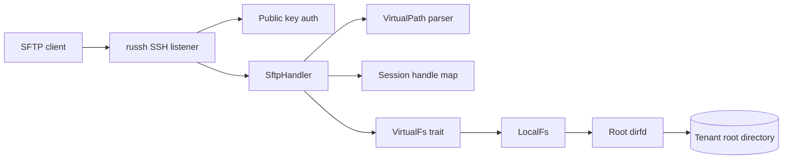
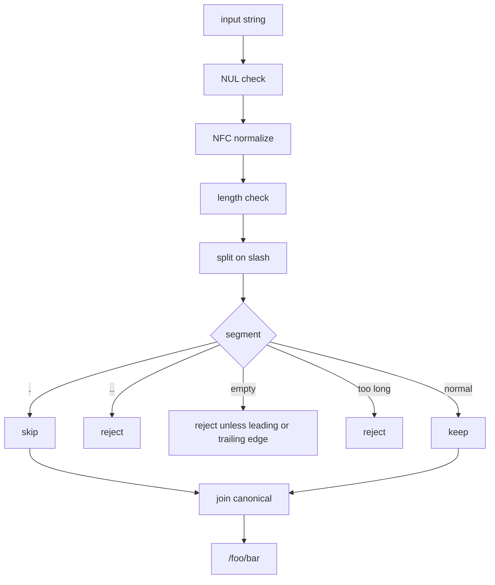
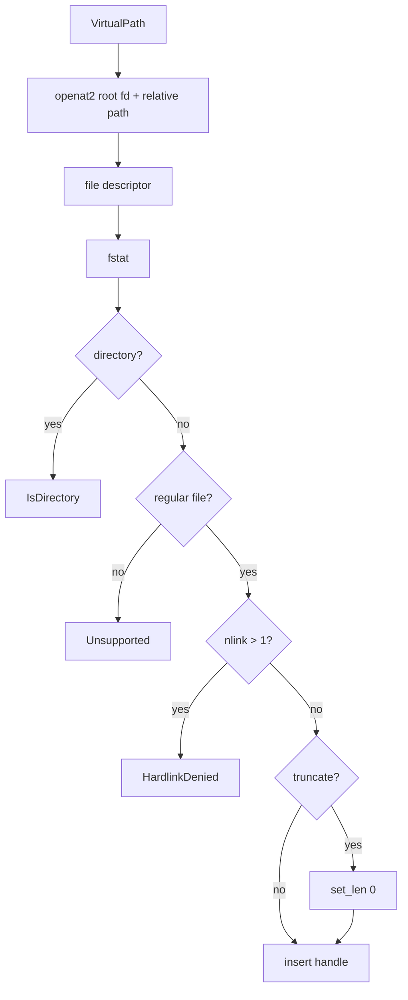
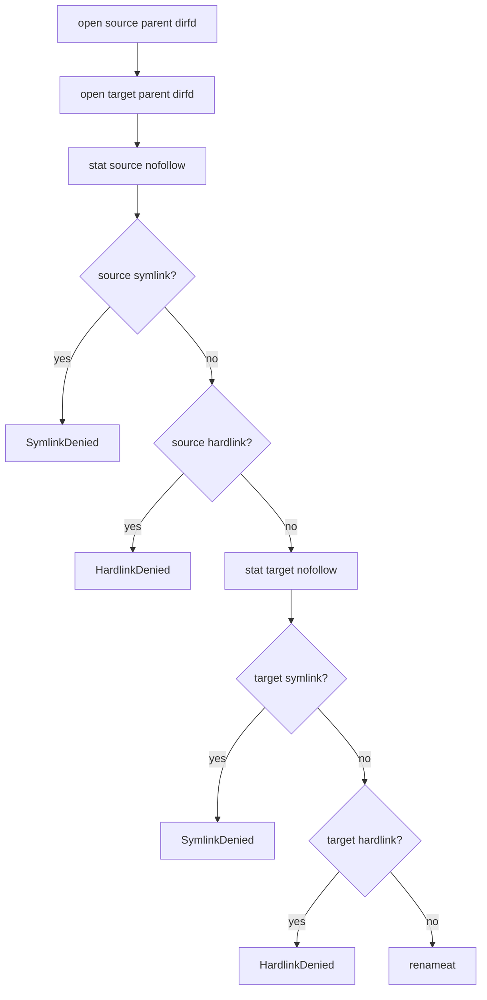
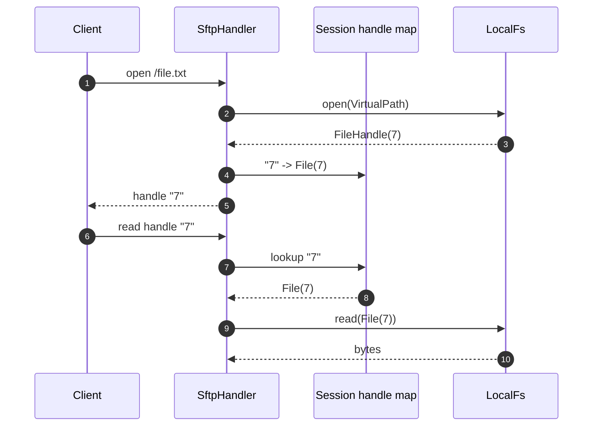

# Phase 1 Reader: Protocol and Containment

- Status: Learning material
- Audience: Musa
- Scope: SFTP v3 server, path parser, `VirtualFs`, `LocalFs`, `openat2`, handles, extensions, tests, fuzzing
- Source of truth: [docs/PLAN.md](../PLAN.md), [docs/TESTING.md](../TESTING.md), [docs/CLIENT-MATRIX.md](../CLIENT-MATRIX.md), [crates/latchix-core/src](../../crates/latchix-core/src), [crates/latchix-sftp/src](../../crates/latchix-sftp/src)

This is a reader, not a test. You do not need to answer anything today. Read the
notes, look at the diagrams, and mark the parts that still feel fuzzy. The Phase
1 checkpoint in [LEARNING.md](../LEARNING.md) can wait.

Phase 1 is where the project stops being a scaffold and becomes a real SFTP
server. The important idea is not "SFTP works". The important idea is that the
filesystem boundary is enforced below the protocol handler, so a protocol bug
does not become a host filesystem bug.

---

## 1. Phase 1 in one page

Phase 1 built a working development SFTP server:

- SFTP v3 over SSH using `russh` and `russh-sftp`
- public key authentication only
- one tenant root per dev server
- virtual path parser with NFC normalization and traversal rejection
- asynchronous `VirtualFs` port
- `LocalFs` adapter bound to one root directory descriptor
- `openat2` containment with `BENEATH`, `NO_SYMLINKS`, `NO_MAGICLINKS`, and
  `NO_XDEV`
- symlink denial
- hardlink denial before truncate
- rename restricted to one root
- session-scoped handle table
- `posix-rename@openssh.com` and `fsync@openssh.com`
- OpenSSH `sftp` and rclone integration tests
- escape, extension, and handle isolation tests
- path and packet fuzz targets
- rootless Podman test harness
- loopback-only dev SFTP server

What Phase 1 did **not** build:

- production database authentication
- users, keys, and tenants from SQLite
- ACL enforcement
- quotas
- audit events on SFTP operations
- `statvfs`, `limits`, `expand-path`, or `hardlink` extensions
- FileZilla manual sign-off
- production wiring in `latchix serve`

The production `latchix serve` command is still health-only. The SFTP listener is
wired through the dev harness until Phase 2 supplies store-backed auth and ACL.

The one-sentence definition:

```text
Phase 1 turns a root directory into a real SFTP endpoint that cannot escape the
root and can be driven by real clients.
```

---

## 2. The layer map



Read it from right to left:

- `DISK` is the real directory. It is the only host path the server starts with.
- `RFD` is an open descriptor for that directory. Every operation is relative to
  it.
- `LocalFs` implements `VirtualFs` using that descriptor and `openat2`.
- `VirtualFs` is the port. The handler does not know whether the backend is
  local, S3, or a test double.
- `SftpHandler` maps SFTP packets to filesystem operations and keeps a
  session-local handle table.
- `russh` handles SSH transport, host keys, channels, and public key auth.
- The client sees virtual paths such as `/upload.txt`. It never sees a host path.

The direction of dependency matters:

```text
russh / SFTP handler  ->  VirtualFs port  ->  LocalFs  ->  root dirfd
```

The filesystem adapter does not depend on the SFTP handler. The boundary is
below the protocol, not inside it.

---

## 3. VirtualPath: the canonical virtual path

The parser lives in `crates/latchix-core/src/path.rs`.



The rules:

| Input | Result | Why |
|---|---|---|
| `""` | `/` | Empty means the root |
| `/` | `/` | Root |
| `foo` | `/foo` | Relative paths become virtual absolute paths |
| `/foo/` | `/foo` | Trailing slash is removed |
| `/foo/./bar` | `/foo/bar` | `.` segments are removed |
| `foo//bar` | error | Empty segment from repeated slash |
| `foo/../bar` | error | Parent traversal is rejected |
| `foo\0bar` | error | NUL is rejected |
| decomposed `e` + accent | NFC `é` | Unicode normalization |
| long path or segment | error | Length limits |

Two points that are easy to miss:

1. **SFTP absolute paths are virtual.**
   `/etc/passwd` means `<tenant root>/etc/passwd`, not the host `/etc/passwd`.
   The parser accepts it as a virtual path. The containment boundary is the root
   descriptor, not the leading slash.

2. **The parser is the first line, not the only line.**
   It rejects `..` and empty segments before the filesystem sees them. The root
   descriptor and `openat2` are the kernel-enforced second line.

The `as_relative()` method returns `"."` for the root and `"foo/bar"` for
`/foo/bar`. That is what `openat2` receives, so every lookup is relative to the
root descriptor.

---

## 4. VirtualFs: the filesystem port

`crates/latchix-core/src/fs.rs` defines the async trait.

| Operation | Purpose |
|---|---|
| `open` | Open a file with read/write/create/truncate/append/exclusive flags |
| `close` | Release a file handle |
| `read` | Read up to `len` bytes at an offset |
| `write` | Write bytes at an offset |
| `stat` | Metadata for a path |
| `lstat` | Metadata without following a final symlink |
| `fstat` | Metadata for an open handle |
| `setstat` | Change attributes by path |
| `fsetstat` | Change attributes by handle |
| `opendir` | Open a directory handle |
| `readdir` | Return the next batch of directory entries |
| `closedir` | Release a directory handle |
| `mkdir` | Create a directory |
| `rmdir` | Remove an empty directory |
| `remove` | Remove a file |
| `rename` | Rename within one root |
| `realpath` | Return the canonical virtual path |
| `fsync` | Flush an open file |

The error type is deliberately small and safe:

```text
NotFound, PermissionDenied, AlreadyExists, NotDirectory, IsDirectory,
InvalidPath, Unsupported, CrossRootRename, HardlinkDenied, SymlinkDenied,
StaleHandle, TooManyHandles, QuotaExceeded, Io
```

Notice what is missing: host paths. The errors do not carry `/var/lib/latchix/...`
or any backend path. That is intentional. Error strings leak information if they
include the host filesystem layout.

`SetAttrs` only carries size, access time, and modification time. Permissions and
ownership are intentionally absent. The SFTP handler rejects those fields before
they reach the filesystem.

Why a trait at all?

- The core can be tested with a mock filesystem.
- The embedded-library story remains possible.
- A future S3 backend can implement the same port.
- The SFTP handler does not need to know the storage backend.

---

## 5. LocalFs and openat2

The adapter lives in `crates/latchix-sftp/src/local_fs.rs`.

### 5.1 The root descriptor

`LocalFs::new(root)` opens the root once:

```text
O_PATH | O_DIRECTORY | O_CLOEXEC
RESOLVE_NO_SYMLINKS | RESOLVE_NO_MAGICLINKS
```

The result is an `OwnedFd` stored in the adapter. Every later operation uses
that descriptor as its base.

The dev server has one root directory. In the production model, Phase 2 resolves
a tenant's root record to a directory. The root model is:

```text
tenant
  └── storage tree
        └── root: default     <- one root per tenant in v0.1, shared by users
```

Roots are not per-user folders. The root record is a storage boundary. In v0.1
the seed creates one default root per tenant, and users point at it through
`home_root_id`.

### 5.2 What `openat2` is, in plain English

`openat2` is a Linux system call. It opens a path relative to an already-open
directory handle and asks the kernel to enforce restrictions during resolution.

A plain-English analogy:

> You hold a handle to the tenant's root folder. You tell the kernel: "Open
> `reports/2026.csv` below this handle. Never go above it. Never follow a
> symlink. Never follow a magic link. Never cross into another mounted disk."
> The kernel resolves and opens in one atomic step.

The flags:

| Flag | What it stops |
|---|---|
| `RESOLVE_BENEATH` | `..` climbing above the root handle |
| `RESOLVE_NO_SYMLINKS` | symlinks anywhere in the path |
| `RESOLVE_NO_MAGICLINKS` | `/proc/self/fd/...` style magic links |
| `RESOLVE_NO_XDEV` | crossing a mount point |

Why not a string prefix check?

- `..` and repeated slashes are easy to miss.
- A symlink can point outside the root.
- A path can be swapped between the check and the `open`.
- `/proc/self/fd/...` can point at an already-open outside file.

Why not `realpath` and then `open`?

That is two steps. An attacker can change the filesystem between them. `openat2`
resolves and opens with the constraints in one kernel operation, which closes
that TOCTOU window.

Why not `chroot`?

`chroot` is process-wide, normally needs privilege, and is not a strong
per-session boundary. A root descriptor plus `openat2` is per-session and does
not require root.

### 5.3 The open path



The open flags include:

- `CLOEXEC`
- `NOFOLLOW`
- `NONBLOCK`
- `RDONLY`, `RDWR`, or `WRONLY`
- `CREATE`, `EXCL`, `APPEND` when requested
- mode `0600` when creating

`NONBLOCK` is there so opening a FIFO or special file does not park a blocking
thread. The file is rejected after `fstat` if it is not a regular file.

The hardlink check happens **before** truncate. That order matters. If a file has
two names, truncating it would modify the other name too.

### 5.4 Hardlinks, the special case

`openat2` keeps the path inside the root. A hardlink is not a path escape. It is
a second name for the same inode.

```text
root/inside.txt  ─┐
                  ├── same inode ── same bytes
outside.txt      ─┘
```

If `inside.txt` has `nlink > 1`, opening and writing it changes the bytes visible
through `outside.txt` as well. `openat2` cannot fix that because the path is
legitimate. The policy is to deny hardlinked regular files.

That is why the checks are:

- `nlink > 1` on open
- `nlink > 1` on `fsetstat`
- `nlink > 1` on rename source and target
- deny before truncate

The policy is intentionally strict. A single-tenant mode could relax it later,
but v0.1 denies it.

### 5.5 Rename



Rename is restricted to one root because both parent directories are opened from
the same root descriptor. There is no cross-root path.

The source and target are checked with `SYMLINK_NOFOLLOW`. A symlink source or
target is denied. A hardlinked regular file source or target is denied.

### 5.6 Remove and readdir

`remove`:

- opens the parent directory descriptor
- stats the entry with `SYMLINK_NOFOLLOW`
- denies symlinks
- denies directories
- calls `unlinkat`

`readdir`:

- opens the directory with `O_RDONLY | O_DIRECTORY | O_NOFOLLOW`
- reads entries once into a snapshot
- skips `.`, `..`, symlinks, and non-UTF8 names
- caps at 100,000 entries
- returns batches of 64
- an empty batch means end of stream

The snapshot means a directory change during listing does not shift the cursor.
It also means the server does not hold a live kernel directory stream across
SFTP requests.

### 5.7 Blocking I/O

`LocalFs` uses `tokio::task::spawn_blocking` for filesystem calls. `openat2`,
`fstat`, `read`, `write`, `rename`, and directory reads are blocking syscalls.
Running them directly on the async runtime would stall other sessions.

The handle maps themselves are guarded by async mutexes, but the syscalls run on
the blocking pool.

### 5.8 What `openat2` does not protect

`openat2` is a path-resolution control. It is not a complete security model.

It does not stop:

- a hardlink to an outside inode
- a local attacker with root or direct filesystem access
- a bug in the ACL layer later
- a quota bypass
- a denial of service through many connections or huge directories
- a protocol bug above the filesystem layer

That is why Phase 1 also has the parser, hardlink policy, handle limits, packet
cap, read cap, and fuzzing.

---

## 6. Handles and session isolation

There are two handle maps:

1. `LocalFs` has a global map from raw handle number to an open file or
   directory state.
2. `SftpHandler` has a per-session map from the SFTP handle string to a typed
   `FileHandle` or `DirHandle`.

The session map is the authority. A client cannot send a guessed raw handle and
reach another session.



Cross-session reuse:

```text
Client A: handle "7" -> A's map -> File(7)   -> works
Client B: handle "7" -> B's map -> not found -> invalid handle
```

This is a real bug that was found during review and fixed. The first version
parsed the handle string as a raw `u64` and passed it to `LocalFs` directly.
Because `LocalFs` is shared by sessions, a client could guess another session's
handle number and read or write that file. The handler now resolves handles only
through its own map.

Two more checks matter:

- A file operation on a directory handle is rejected.
- A directory operation on a file handle is rejected.

The maps are capped at 4,096 entries each. A session that leaks handles eventually
gets `TooManyHandles` instead of growing without bound. `Drop` performs a
best-effort close of anything left open.

---

## 7. The SFTP handler

`crates/latchix-sftp/src/handler.rs` implements the `russh-sftp` server handler.

| SFTP request | Filesystem operation |
|---|---|
| `open` | `VirtualFs::open` |
| `close` | `VirtualFs::close` or `closedir` |
| `read` | `VirtualFs::read` |
| `write` | `VirtualFs::write` |
| `stat` / `lstat` | `VirtualFs::stat` / `lstat` |
| `fstat` | `VirtualFs::fstat` |
| `setstat` | `VirtualFs::setstat` |
| `fsetstat` | `VirtualFs::fsetstat` |
| `opendir` | `VirtualFs::opendir` |
| `readdir` | `VirtualFs::readdir` |
| `closedir` | `VirtualFs::closedir` |
| `remove` | `VirtualFs::remove` |
| `mkdir` | `VirtualFs::mkdir` |
| `rmdir` | `VirtualFs::rmdir` |
| `rename` | `VirtualFs::rename` |
| `realpath` | `VirtualFs::realpath` |
| `fsync` extension | `VirtualFs::fsync` |
| `posix-rename` extension | `VirtualFs::rename` |

Behavior details:

- `read` returns `SSH_FX_EOF` when the backend returns no bytes.
- `readdir` returns `SSH_FX_EOF` when the next batch is empty.
- `setstat` and `fsetstat` accept only size changes. Permissions, ownership, and
  timestamps return `SSH_FX_OP_UNSUPPORTED`.
- `mkdir` uses mode `0700`.
- Created files use mode `0600`.
- `readlink` and `symlink` are unsupported.
- `realpath` returns the canonical virtual path. It does not expose a host path.
- Unknown extensions return `SSH_FX_OP_UNSUPPORTED`.
- Malformed extension data returns `SSH_FX_BAD_MESSAGE`.
- `posix-rename` and `fsync` are advertised in the version handshake.

The handler also maps `FsError` to SFTP status codes:

| `FsError` | SFTP status |
|---|---|
| `NotFound` | `SSH_FX_NO_SUCH_FILE` |
| `PermissionDenied`, `SymlinkDenied`, `HardlinkDenied`, `InvalidPath`, `CrossRootRename` | `SSH_FX_PERMISSION_DENIED` |
| `AlreadyExists` | `SSH_FX_FAILURE` with "already exists" |
| `NotDirectory` | `SSH_FX_FAILURE` with "not a directory" |
| `IsDirectory` | `SSH_FX_FAILURE` with "is a directory" |
| `Unsupported` | `SSH_FX_OP_UNSUPPORTED` |
| `StaleHandle` | `SSH_FX_FAILURE` with "stale handle" |
| `TooManyHandles` | `SSH_FX_FAILURE` with "too many open handles" |
| `QuotaExceeded` | `SSH_FX_FAILURE` with "quota exceeded" |
| `Io` | `SSH_FX_FAILURE` with "filesystem error" |

Notice the errors do not include the host path. The client gets a status code and
a short message, not the server's directory layout.

### 7.1 Extensions

The server advertises:

- `posix-rename@openssh.com` version `1`
- `fsync@openssh.com` version `1`

`posix-rename` carries two SSH strings: old path and new path. `fsync` carries
one SSH string: the handle. The parser rejects truncated data, invalid UTF-8, and
trailing bytes.

Other extensions are rejected explicitly. The server does not pretend to support
`limits`, `statvfs`, `expand-path`, or `hardlink`.

---

## 8. The SSH server

`crates/latchix-sftp/src/server.rs` wraps `russh`.

`SftpServerConfig` contains:

- bind address
- host keys
- authorized client public keys
- root directory
- tenant ID
- root ID

Authentication:

- `auth_publickey` computes the SHA256 fingerprint and checks the authorized set.
- Any username is accepted if the key is authorized. This is a dev harness
  behavior. Phase 2 resolves the key to a tenant and user.
- `auth_password` always rejects.
- CLI config validation rejects RSA host keys before startup. The dev harness
  generates Ed25519 keys. RSA user keys remain usable for verification.

Channel behavior:

- only the `sftp` subsystem is accepted
- the subsystem requires an authenticated user
- the SFTP packet cap is 256 KiB
- `SIGTERM`/`SIGINT` shutdown goes through `ServerHandle::shutdown`

The server shares one `Arc<LocalFs>` across sessions, but each session gets its
own `SftpHandler` and handle map. That is why session-scoped handles matter.

### 8.1 SSHole is not applicable

SSHole is CVE-2026-123158. It is a server-side OpenSSH password-authentication
bug on musl with PAM disabled. It lets oversized passwords match accounts whose
password hash is `*`.

Latchix does not use OpenSSH `sshd`. It uses the Rust `russh` library, supports
public key authentication only, and rejects password authentication. The
OpenSSH `sftp` client in the tests is a client, not the vulnerable server.

No code change is needed for SSHole. A host running an unpatched OpenSSH `sshd`
is a separate host-security issue.

---

## 9. Containment threat table

| Attempt | What stops it | Test |
|---|---|---|
| `..` in a path | parser, `RESOLVE_BENEATH` | path tests, `local_fs` |
| Absolute host path | path is virtual, root descriptor | `openssh`, path tests |
| Symlink to outside | `NO_SYMLINKS`, `NOFOLLOW`, stat nofollow | `symlink_is_denied` |
| Symlink parent | `NO_SYMLINKS` on directory open | `symlink_parent_is_denied` |
| Magic link `/proc/self/fd/...` | `RESOLVE_NO_MAGICLINKS` | containment policy |
| Mount crossing | `RESOLVE_NO_XDEV` | containment policy |
| Hardlink to outside inode | `nlink > 1` denial | `hardlink_is_denied_before_truncate` |
| Hardlink rename | source/target `nlink > 1` denial | `hardlink_rename_is_denied` |
| Symlink rename source | stat nofollow + deny | `rename_symlink_source_is_denied` |
| Symlink rename target | stat nofollow + deny | `rename_onto_symlink_is_denied` |
| Remove symlink | stat nofollow + deny | `remove_symlink_is_denied` |
| Cross-session handle | session handle map | `handles_are_scoped_to_one_session` |
| Guessed raw handle | session handle map | `handles_are_scoped_to_one_session` |
| Malformed extension | bounded parser + `BAD_MESSAGE` | `malformed_and_unknown_extensions_fail_closed` |
| Unsupported extension | explicit `OP_UNSUPPORTED` | extension test |
| Oversized read | `MAX_READ_SIZE` 1 MiB | code review |
| Too many handles | `MAX_HANDLES` 4,096 | code review |
| Huge directory | 100,000 entry cap | code review |
| Malformed packet | packet cap + fuzz target | `fuzz_packet` |

### 9.1 TOCTOU

TOCTOU means "time of check to time of use". A naive implementation does:

```text
check path is safe
open path
```

An attacker can change a directory or symlink between those two steps.

`openat2` combines resolution and open with constraints. The parser and stat
checks are still useful defense in depth, but the kernel boundary is the one that
matters.

There are still local races in remove and rename, but a remote SFTP client cannot
win them without local filesystem access. The design assumes the host operator
and local root are trusted.

### 9.2 What Phase 1 does not protect

- ACL decisions. Those arrive in Phase 2.
- Quota enforcement. Those arrive in Phase 2.
- Audit events for transfers. Those arrive in Phase 2.
- A compromised host or a local root attacker.
- Denial of service from connection floods. Limits exist but are not complete.
- FileZilla-specific behavior. That is the manual check.

---

## 10. Test map

The Phase 1 tests are split by what they prove.

| Test file or module | Count | What it proves |
|---|---:|---|
| `crates/latchix-core/src/path.rs` | 11 | path forms, traversal, NUL, empty segments, NFC, limits |
| `crates/latchix-core/src/fs.rs` | 9 | handle types, metadata, defaults, errors, mock backend, dyn trait |
| `crates/latchix-core/src/lib.rs` | 3 | tenant/root ID round trips |
| `crates/latchix-sftp/src/server.rs` | 3 | host key validation, empty host key rejection |
| `crates/latchix-sftp/tests/local_fs.rs` | 14 | filesystem behavior and escape denial |
| `crates/latchix-sftp/tests/extensions.rs` | 4 | extension handshake, posix-rename, fsync, malformed data |
| `crates/latchix-sftp/tests/handles.rs` | 2 | file and directory handle isolation |
| `crates/latchix-sftp/tests/openssh.rs` | 1 | real OpenSSH `sftp` batch round trip |
| `crates/latchix-sftp/tests/rclone.rs` | 1 | real rclone copy round trip |

A full workspace run currently reports 68 passing tests. The Phase 1 core and
SFTP crates account for 48 of them.

### 10.1 The filesystem tests

`local_fs.rs` covers:

- create, write, read, close
- symlink denial
- symlink parent denial
- hardlink denial before truncate
- hardlink rename denial
- symlink rename source denial
- symlink rename target denial
- remove symlink denial
- rename within root
- mkdir, readdir, rmdir, remove
- setstat size change
- setstat on hardlink denial
- open directory and opendir file failures
- stale handles

The important one is `hardlink_is_denied_before_truncate`. It proves the check
happens before the file is modified, not after.

### 10.2 The client tests

`openssh.rs` starts a real `russh` listener on an ephemeral localhost port and
runs a real `sftp` batch:

```text
put
ls
get
mkdir
rename
rm
rmdir
```

`rclone.rs` starts the same kind of server and runs a real `rclone copy` with
binary content.

The OpenSSH test sets `IdentitiesOnly=yes` and `IdentityAgent=none` so a local
SSH agent cannot inject extra keys and make the test non-deterministic.

### 10.3 Commands

```bash
cargo test -p latchix-core
cargo test -p latchix-sftp
cargo test --workspace --all-features
```

Containerized:

```bash
scripts/test-container.sh
scripts/test-container.sh -- cargo test --locked -p latchix-sftp
scripts/test-container.sh -- cargo clippy --locked --workspace --all-targets --all-features -- -D warnings
```

The container mount is read-only. Cargo target and registry data live in named
Podman volumes.

---

## 11. Fuzzing

Two fuzz targets live in `fuzz/`:

### `fuzz_path`

```text
arbitrary bytes -> UTF-8 lossy string -> VirtualPath::parse
```

It exercises NUL, Unicode normalization, empty segments, long input, and
traversal.

### `fuzz_packet`

```text
arbitrary bytes -> russh-sftp Packet::try_from
```

It exercises the SFTP packet decoder with malformed and truncated input.

Last smoke runs:

- `fuzz_path`: 261,030 executions in 6 seconds
- `fuzz_packet`: 617,730 executions in 6 seconds
- no crashes, no artifacts

Fuzzing is evidence of robustness, not proof of security. It does not replace the
escape tests, the ACL tests, or a future external audit.

Run it with the recipe in [TESTING.md](../TESTING.md). Cargo fuzzing writes
corpora and artifacts, so the source tree is copied into the container's tmpfs
first.

---

## 12. Container harness

The test environment is rootless Podman with a read-only source mount.

`Containerfile.test` contains:

- Rust 1.99.1
- Clippy and rustfmt
- musl target
- nightly toolchain
- `cargo-fuzz`
- OpenSSH client
- rclone
- strace
- build tools

`scripts/test-container.sh` runs the container with:

- `--read-only`
- `--userns=keep-id`
- `--user` matching the host UID/GID
- `--security-opt=no-new-privileges`
- `--cap-drop=ALL`
- a 4 GiB `/tmp` tmpfs
- read-only `/src`
- named volumes for `/target` and `/cargo`

`scripts/sftp-dev-container.sh` runs the dev server with:

- loopback-only port publishing
- a host data directory
- a generated client key
- `--read-only` and `--cap-drop=ALL`

The point is to avoid host filesystem changes and to test as an unprivileged
user. FileZilla remains a manual host check because it is a GUI client.

---

## 13. The dev server

The example is `crates/latchix-sftp/examples/dev_server.rs`.

It creates:

- a data directory
- a root directory
- a host key
- a client key

Then it starts the server and prints a ready-to-paste `sftp` command.

```bash
scripts/sftp-dev-container.sh
```

It prints the port, root, and client key path. FileZilla connects to
`127.0.0.1:2222` as `demo` with `.ci/sftp-dev/id_ed25519`.

The dev server is intentionally not production. It has one fixed tenant context
and no database.

---

## 14. Code tour

Start with the boundary, not the protocol.

### `crates/latchix-core/src/path.rs`

Read `VirtualPath::parse`, `as_relative`, `parent`, and `file_name`. Notice that
the parser canonicalizes and rejects, but does not touch the filesystem.

### `crates/latchix-core/src/fs.rs`

Read the `VirtualFs` trait and `FsError`. Notice that errors do not carry host
paths. Read `SetAttrs` to see what is intentionally not changeable.

### `crates/latchix-sftp/src/local_fs.rs`

Read `LocalFs::new`, `open`, `open_dir_fd`, `rename`, `remove`, `read_dir_entries`,
and `map_errno`.

Look for the order in `open`:

1. `openat2`
2. `fstat`
3. reject directory
4. reject non-regular
5. reject `nlink > 1`
6. truncate if requested
7. insert handle

That order is the security property.

### `crates/latchix-sftp/src/handler.rs`

Read `file_handle`, `dir_handle`, `read`, `write`, `extended`, and `Drop`.

Look for the session map lookup before any raw handle reaches `LocalFs`. That is
the cross-session isolation property.

### `crates/latchix-sftp/src/server.rs`

Read `SftpServerConfig`, `spawn`, `auth_publickey`, `auth_password`, and
`subsystem_request`.

Notice that password auth is always rejected and only the `sftp` subsystem is
accepted.

### `crates/latchix-sftp/tests/`

Read `local_fs.rs` first, then `handles.rs`, then `extensions.rs`. The client
tests are integration proof, but the escape tests explain the model.

### `docs/TESTING.md` and `docs/CLIENT-MATRIX.md`

These are the operational instructions. `TESTING.md` explains the container and
fuzz commands. `CLIENT-MATRIX.md` records which clients are automated and which
are manual.

---

## 15. If you remember only twelve things

1. SFTP absolute paths are virtual. `/etc/passwd` is under the tenant root.
2. The root is a directory descriptor, not a string.
3. `openat2` uses `BENEATH`, `NO_SYMLINKS`, `NO_MAGICLINKS`, and `NO_XDEV`.
4. Hardlinks are denied with `nlink > 1`, before truncate.
5. Symlinks are denied at open, stat, readdir, remove, and rename.
6. The session handle map is the authority. Never trust a raw handle string.
7. File handles and directory handles are typed and cannot be confused.
8. `posix-rename` and `fsync` are the only advertised extensions.
9. Errors never leak host paths.
10. Blocking filesystem calls run on `spawn_blocking`.
11. OpenSSH and rclone are automated. FileZilla is manual.
12. The production `latchix serve` remains health-only until Phase 2 auth and ACL.

---

## 16. Reading path

No answers required. Use a timer only to stop over-reading.

| Time | Read | What to look for |
|---|---|---|
| 10 min | Sections 1 to 3 | The layer map and virtual paths |
| 15 min | Sections 4 to 5 | The port and the `openat2` boundary |
| 10 min | Section 6 | Session handle isolation |
| 10 min | Sections 7 and 8 | SFTP mapping, extensions, public key auth |
| 10 min | Section 9 | The escape table and hardlink reasoning |
| 10 min | Sections 10 to 12 | Tests, fuzzing, container harness |
| 10 min | Section 14 | Code tour with the files open |

If you only have thirty minutes:

1. Read the layer map.
2. Read the `openat2` section.
3. Read the hardlink section.
4. Read the session handle section.
5. Stop. Do not force the rest.

---

## 17. Unknowns log starter

| Question | Where to look |
|---|---|
| Why does `openat2` need a directory descriptor instead of a path string? | Section 5, `local_fs.rs` |
| Why can a hardlink escape even when the path stays inside the root? | Section 5.4 |
| Why is the hardlink check before truncate? | `LocalFs::open` |
| Why is `O_NONBLOCK` used on open? | `LocalFs::open` |
| Why does `readdir` snapshot entries instead of holding a live directory stream? | `read_dir_entries` |
| Why does the session handle map matter if `LocalFs` already has a handle map? | Section 6 |
| Why are file and directory handles separate? | `HandleKind` |
| Why does `realpath` not check existence? | `SftpHandler::realpath` |
| Why are permissions and timestamps rejected in `setstat`? | `parse_set_attrs` |
| Why is `posix-rename` advertised but `hardlink` is not? | Section 7.1 |
| Why is the packet cap 256 KiB? | `server.rs` |
| Why does the SSH test disable the SSH agent? | `openssh.rs` |
| What would change if `openat2` is unavailable on an old kernel? | fail closed, no string fallback |
| What is still missing before production? | Section 1 and Phase 2 plan |

---

## 18. Optional escape lab, when you are ready

This is the Phase 1 checkpoint from `LEARNING.md`. Do not do it today. Read it
once so the shape is familiar.

1. Start the dev server:

   ```bash
   scripts/sftp-dev-container.sh
   ```

2. Connect with OpenSSH:

   ```bash
   sftp -i .ci/sftp-dev/id_ed25519 -P 2222 \
     -o StrictHostKeyChecking=no \
     -o UserKnownHostsFile=/dev/null \
     demo@127.0.0.1
   ```

3. Try four escapes and predict the result before each one:

   - `cd ..`
   - `get /etc/passwd`
   - a symlink under the root pointing outside
   - a hardlink under the root to an outside file

4. Explain why `RESOLVE_BENEATH` does not stop the hardlink.

5. Find one place where a string prefix check would have accepted a malicious
   path.

6. Trace one `open` with `strace` and find:

   - the root dirfd
   - the `openat2` call
   - the resolve flags
   - the `fstat` checks

Pass condition later: you can explain the containment model without opening the
code and predict the result of each attempt.

---

## 19. What Phase 1 is not

Phase 1 is not the ACL. It is not the database. It is not the control plane. It
is not the admin UI.

Phase 1 is the protocol and containment core:

- SFTP v3 works with real clients
- every path is virtual
- every filesystem operation is root-relative
- symlinks and hardlinks are denied
- handles are session-scoped
- malformed packets do not panic
- the test harness is reproducible

If you can explain those seven things, you understand Phase 1.
